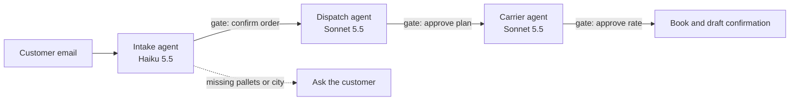

# Dockhand

**Dockhand does the legwork. You make the call.**

A proof of concept for an agentic control tower for outbound dispatch at a Malaysian distribution centre (Shah Alam DC, Klang Valley). Three agents turn a customer's email into a booked truck: they read the request, plan the load and negotiate the carrier rate. A dispatcher approves each important step, and the agents can be allowed to run on their own within hard limits.

Built for the Teoh Capital AI Product Manager case study. The scoping pack explains the problem, the customer and the roadmap; this repo is the working end-to-end workflow behind it.

## Run it

Needs Node 20.12 or newer.

```bash
npm install
cp .env.example .env.local      # optional: add ANTHROPIC_API_KEY to use Claude
npm run dev                      # http://localhost:3000
```

Without a key the app runs **scripted agents**: the same tools, guardrails, gates and audit trail, with rule-based reasoning instead of the model. The header shows which mode is on. Set `DOCKHAND_SCRIPTED=1` to force scripted mode even with a key.

### A two-minute walkthrough

1. **Kedai Harian** is waiting for you. The intake agent has read the email. Confirm the order.
2. The dispatch agent adds the 14 pallets to the open Penang load LD-2291 (24 of 26 pallets) and picks the last dock slot that still meets Thursday's deadline. Approve the plan.
3. The carrier agent skips a haulier whose APAD permit has lapsed, gets two quotes, checks the lane benchmark and negotiates. Read the two messages, then book.
4. Click **+ Test request**, pick **A vague request** and send it. The intake agent refuses to guess the missing pallet count and city, so the only option is to ask the customer.
5. Turn on **Auto-run** and send **Chilled produce to Ipoh**. It goes from email to booked with no clicks, because nothing broke a limit.
6. **Loads**, **Carriers** and **Activity** show the result and every action, by agent or by you.

## How it works



Each agent is a short tool-use loop on the Claude API. It may call its data tools, then must submit a structured answer (an order, a load plan or a deal) through a final tool. Code then checks that answer against the hard limits before anything is shown or saved.

| Agent | Model | Tools it can call | Submits |
|---|---|---|---|
| Intake | `claude-haiku-5-5` (fast, cheap, high volume) | none, reads the email | `submit_order` |
| Dispatch | `claude-sonnet-5-5` | `tms_open_loads`, `wms_dock_slots` | `submit_plan` |
| Carrier | `claude-sonnet-5-5` | `carriers_eligible`, `carriers_request_quotes`, `tms_lane_benchmark` | `submit_deal` |

The counter-offer itself (`carriers_send_counter`) is sent by code after the guardrails, not by the model. Models are set in one adapter (`lib/agents/llm.ts`) and can be changed with `DOCKHAND_FAST_MODEL` and `DOCKHAND_SMART_MODEL`.

### Request states and gates

Every request moves through `intake → dispatch → carrier → booking`, and each step is `running`, `review`, `approved`, `blocked` or `done`. The control tower groups requests as **Needs you**, **Agents working**, **Waiting on the customer** and **Booked**.

| Autonomy | What happens |
|---|---|
| Approve every step (default) | Each agent stops at a gate until a person approves. |
| Auto-run | Gates open on their own, except when an order has missing fields, or a negotiated rate is above the lane benchmark. Those always wait for a person. |

This is the first rung of the autonomy ladder in the scoping pack. Wider autonomy (auto-booking within a budget, then exception-only review) is earned per lane from approval and override rates.

### Guardrails, in code rather than prompts

| Limit | Where | What it does if the model gets it wrong |
|---|---|---|
| Nothing is planned without a pallet count and a served city | `rules.ts` `blockersOf`, `machine.ts` `approve` | The order cannot be confirmed; the only action is to ask the customer. |
| A truck holds 26 pallets, and loads only share a destination and temperature | `agents.ts` `dispatchAgent` | Rejects the consolidation and opens a new load, with a note. |
| The dock slot must meet the delivery deadline | `rules.ts` `slotOk`, `pickSlot` | Moves the pickup to the latest slot that still meets it. |
| Only carriers with a valid APAD Class A permit and the right equipment | `rules.ts` `eligibleCarriers` | Replaces the pick with an eligible carrier. |
| Counter-offers stay between 88% and 100% of the quote | `rules.ts` `clampCounter` | Clamps the number before it is sent. |
| Auto-run never books above the lane benchmark | `machine.ts` `carrier` | Holds the booking for a person. |
| Two requests cannot claim the same open load | `tools.ts` `openLoads`, `ctx.reserved` | The second request no longer sees the reserved load. |
| A model error or timeout never stops the flow | `agents.ts` | The scripted agent runs instead, and the step says so. |

Every intervention is written to the step's notes, and every tool call (input and output) is recorded on the step that made it. Open **How the agents worked** on any request to see them.

## Tests and evals

```bash
npm test          # 26 unit and workflow tests, scripted, no key needed
npm run eval      # 10 recorded requests through the full workflow
npm run typecheck
```

- `tests/rules.test.ts`: slots, missing fields, permits, counter-offer limits, benchmark pricing.
- `tests/machine.test.ts`: the full approve flow, auto-run, a vague request, holding above the benchmark, no double consolidation, the audit trail.
- `tests/guardrails.test.ts`: a fake Claude client returns bad answers on purpose (wrong load, late slot, lapsed carrier, lowball counter, prose instead of a tool call, timeouts) and the code catches each one.
- `evals/`: ten recorded requests, including Malay and English mixed, kilograms instead of pallets, an unserved city and a temperature mismatch. Each is scored on **accuracy** (did it read and plan correctly, reported as a rate) and **safety** (did any limit break, which must be 100% or the run fails). With a key it replays against Claude; without one it scores the scripted baseline.

Scripted baseline today: accuracy 92% (49 of 53 checks), safety 100% (40 of 40). The one miss is the Malay request, which the regex reader cannot parse. That gap is the case for the model. CI (`.github/workflows/ci.yml`) runs typecheck, tests, evals and build on every push, and replays against Claude when `ANTHROPIC_API_KEY` is set as a repo secret.

## Decisions and trade-offs

| Decision | Why | Cost |
|---|---|---|
| Claude through one adapter | Reads messy free text well and calls tools reliably. | One vendor; every call goes through `llm.ts`, so a switch stays local. |
| Haiku for intake, Sonnet for planning and negotiation | Cheap for high-volume reading, more reasoning where it pays. | Two models to evaluate and monitor. |
| `tool_choice: auto`, plus a nudge to submit | Sonnet 5.5 rejects forced tool use while thinking is on. | One extra turn when a model answers in prose. |
| Own state machine, no agent framework | Gates, retries and the audit trail behave the same every time. | More code to own. |
| Hard limits in code | Capacity, deadlines, rate ceilings and permits never depend on a prompt. | Rules need upkeep as operations change. |
| Scripted fallback for every agent | The demo and the dispatcher's day never stop on a model error. | Two code paths to keep in step; evals cover both. |
| In-memory store for the POC | Zero setup for reviewers. | State resets on restart. `db/schema.sql` is the Postgres schema for the pilot. |
| Next.js app, API routes as the orchestrator | One deployable, quick to ship solo (Vercel, Postgres in Singapore for the pilot). | Long agent runs hold a request open; the pilot moves them to a queue. |

## What is mocked

- **WMS, TMS and carrier systems.** Tools return seeded data (`lib/tools/data.ts`): six dock slots, four open or booked loads, five carriers, one with an expired APAD permit.
- **Carrier replies.** A simulated carrier accepts a counter at 95% of its quote or more, otherwise meets halfway.
- **Email.** Three requests are pre-loaded as read on arrival; new ones come from the **Test request** box.
- **Rates.** Quotes and the lane benchmark are RM per km by lane, with a reefer and small-truck factor. Real rates would come from the TMS and carrier contracts.
- **Dates.** The demo week is fixed to 16 to 20 Nov 2026.

## Project structure

```
app/                  Next.js pages and API routes (state, requests, approve, ask, settings, reset)
components/           ControlTower.tsx, the dispatcher's UI
lib/domain/           types and business rules (pure functions, no I/O)
lib/tools/            typed tool adapters and seeded mock data
lib/agents/           Claude adapter (llm.ts) and the three agents
lib/orchestrator/     state machine, store, snapshot for the UI
tests/  evals/        vitest suites and the replay evals
db/schema.sql         Postgres schema for the pilot
```

## Limits of this POC

- One site, one user, no login or roles.
- State is in memory and resets on restart or `Start the demo over`.
- Agent runs are synchronous inside the API request (fine for a demo, a queue for the pilot).
- No real inbox, WMS, TMS or carrier integration, no PDPA retention jobs, no MyInvois e-invoicing.
- Confirmations and clarifications are drafted, not sent.

These are the Phase 1 pilot items in the scoping pack.
